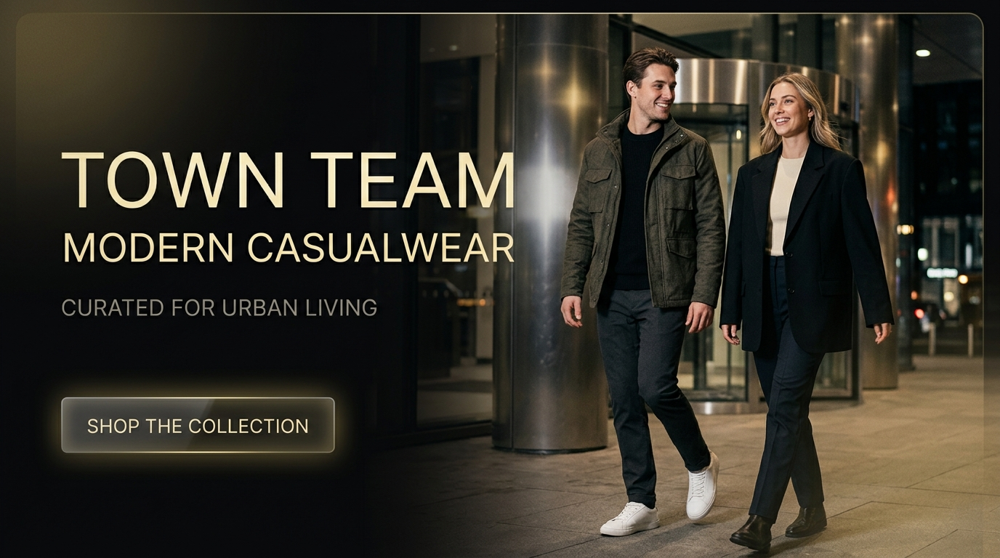
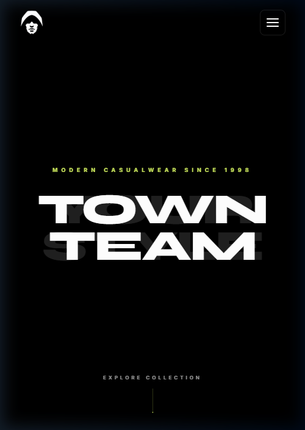
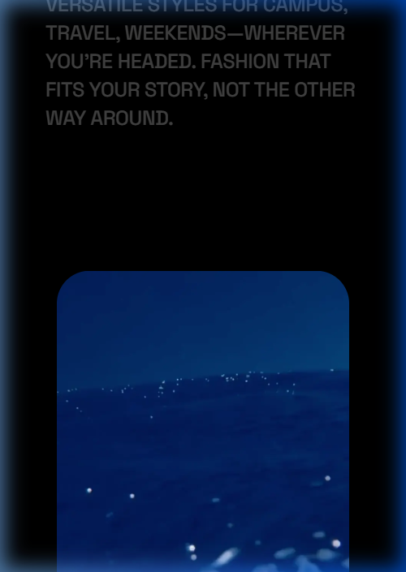

<div align="center">

# TOWN TEAM — MODERN CASUALWEAR
### High-Performance Interactive Digital Fashion Showcase & E-Commerce Experience

[](LICENSE)
[](https://vitejs.dev/)
[](https://greensock.com/gsap/)
[](https://lenis.darkroom.engineering/)
[](https://github.com/aanasmahfouz)

<br />

<p align="center">
  
</p>

<p align="center">
  <strong>An immersive, editorial digital fashion showcase engineered for high-performance creative web experiences.</strong><br>
  Designed & Engineered by <a href="https://github.com/aanasmahfouz"><strong>Anas Mahfouz</strong></a>
</p>

[Explore The Engineering](#-key-engineering-highlights) •
[Architecture](#-codebase-architecture) •
[Getting Started](#-getting-started) •
[Tech Stack](#-technical-stack) •
[License](#-license)

</div>

---

## ✦ Brand Story & Project Overview

Founded in 1998, **Town Team** stands as a staple in contemporary Egyptian casual menswear and streetwear. This application transforms traditional retail e-commerce into a dynamic, narrative-driven digital editorial.

Rather than static product grids, this showcase immerses users into the brand's lifestyle philosophy through high-precision kinetic typography, buttery 60 FPS frame-by-frame canvas scrubbing, smooth inertia scrolling, and interactive 3D perspective product cards.

---

## ✦ Visual Showcase

<div align="center">
  <table>
    <tr>
      <td width="50%">
        
        <p align="center"><em>Interactive Hero & Curtain Wipe Entry</em></p>
      </td>
      <td width="50%">
        
        <p align="center"><em>Curated Collections & 3D Interactive Perspective Cards</em></p>
      </td>
    </tr>
    <tr>
      <td colspan="2" align="center">
        
        <p align="center"><em>Asymmetric Editorial Staggered Imagery on Mobile & Small Screens</em></p>
      </td>
    </tr>
  </table>
</div>

---

## ✦ Key Engineering Highlights

### 1. 60 FPS Canvas Lookbook Scrubbing Engine (`lookbookCanvas.js`)
- **Frame-by-Frame Scrubbing:** Drives a 421-frame 1080p fashion motion sequence synchronized directly to user scroll position via **GSAP ScrollTrigger**.
- **Double-Buffering & Offscreen Pipeline:** Eliminates canvas flickering during rapid inertia scrolls by maintaining an offscreen buffer and drawing complete frames in microtasks.
- **Adaptive HiDPI Device-Pixel-Ratio (DPR) Scaling:** Automatically computes physical canvas dimensions matched to retina screens (`window.devicePixelRatio`), maintaining crisp fabric and silhouette details without GPU thermal throttling.
- **Progressive Memory-Safe Image Preloader:** Employs concurrent queue decoding (`Image.decode()`) with memory caps, ensuring rapid initial interaction while caching subsequent frames smoothly.

### 2. Dual-Curtain Wipe Reveal Transition (`curtainReveal.js`)
- **Multi-Layer Staged Unveiling:** An editorial entrance system that coordinates an ambient preloader with twin curtain panels using cubic-bezier timing curves (`power4.inOut`).
- **Scroll Lock & Virtual Position Normalization:** Locks window scroll during boot, normalizes touch/mousewheel deltas, and seamlessly hands control over to Lenis smooth scroll upon completion.

### 3. Synchronized Inertial Scrolling (`lenisScroll.js`)
- **Lenis + GSAP ScrollTrigger Integration:** Binds Lenis's RAF cycle to `gsap.ticker`, ensuring mathematical sync between natural scroll inertia and animation triggers without layout jitter.
- **Smart Lag Smoothing:** Dynamically disables GSAP lag smoothing on high-refresh-rate displays (120Hz/144Hz ProMotion) to preserve micro-responsiveness.

### 4. Zero-Radius Editorial Philosophy Sections (`philosophy-section.css`)
- **Strict Razor-Sharp Border Styling:** Enforces `border-radius: 0 !important` across all philosophy imagery (`.contentimg`), upholding high-fashion brutalist/editorial aesthetic standards.
- **Responsive Staggered Editorial Duo:** Desktop delivers an expansive dual-card offset layout (>1024px); mobile dynamically transforms into an asymmetric staggered duo (<=1024px), ensuring visual continuity without hiding brand campaign imagery.

### 6. Mobile & Small Screen Hover Disablement for Maximum Performance
- **Zero Sticky Hover Bugs:** Automatically disables all hover effects, hover transitions, and sticky pseudo-states on small screens (`<= 1024px`) and touch devices (`pointer: coarse`).
- **Battery & GPU Savings:** Halts cursor tracking, mousemove parallax, and interactive hover transformations on mobile viewports to ensure smooth 60 FPS touch scrolling without unnecessary repaints.

---

## ✦ Codebase Architecture

```plaintext
town-team/
├── .github/
│   └── assets/                    # High-res repository banners & preview screenshots
├── public/
│   ├── assets/                    # Optimized WebP imagery & branding graphics
│   ├── fonts/                     # Self-hosted typography (Syne, Space Grotesk, Inter, Priestacy)
│   ├── lookbook-frames/           # 421 optimized lookbook canvas animation frames
│   └── videos/                    # Brand campaign cinematic loops
├── src/
│   ├── scripts/
│   │   ├── script.js              # Core orchestration, scroll triggers & product animations
│   │   ├── three.js               # Three.js 3D model engine with capability-aware tracking
│   │   ├── town-team-hero.js      # Hero typography & desktop mouse parallax
│   │   ├── town-team-navigation.js# Fullscreen luxury overlay navigation
│   │   ├── curtain-reveal.js      # Dual-curtain wipe reveal introduction
│   │   ├── splitText.js           # Kinetic typography & character splitter
│   │   ├── textPressure.js        # Dynamic variable font pressure effect
│   │   └── menu-hover-images.js   # Dynamic menu background image switching
│   └── styles/
│       ├── style.css              # Global tokens, reset, typography & mobile optimizations
│       ├── town-team-hero.css     # Hero typography & lighting effects
│       ├── town-team-navigation.css# Responsive navigation & menu drawer
│       ├── curtain-reveal.css     # Curtain animation layers
│       ├── philosophy-section.css # Editorial zero-radius layouts
│       └── shopping-section.css   # Product carousel & responsive cards
├── index.html                     # Semantic HTML5 template with complete SEO/OG metadata
├── package.json                   # Project manifests & dependencies
├── vite.config.js                 # Rollup chunk optimization & Vite configuration
├── LICENSE                        # MIT License (Anas Mahfouz)
└── README.md                      # Comprehensive project documentation
```

---

## ✦ Technical Stack

| Layer | Technology | Purpose |
|---|---|---|
| **Build & Tooling** | **Vite 6** | Lightning-fast HMR and optimized Rollup production bundling |
| **Animation Engine** | **GSAP 3 + ScrollTrigger** | High-precision timeline sequencing and scroll synchronizations |
| **Smooth Scroll** | **Lenis 1.2** | Lightweight, decoupled inertial smooth scrolling |
| **Canvas Scrubbing** | **HTML5 Canvas 2D (HiDPI)** | 60 FPS 421-frame WebP sequential playback without video decoding lag |
| **Styling** | **Modern Vanilla CSS + CSS Variables** | Bespoke design system, fluid `clamp()` sizing, and zero framework bloat |
| **Typography** | **Syne, Space Grotesk, Inter** | Curated high-fashion typography hierarchy |
| **Icons** | **Remix Icon 4.6** | Crisp, lightweight SVG iconography |
| **Asset Pipeline** | **WebP + Sharp** | Next-gen image compression maintaining 100% visual fidelity |

---

## ✦ Getting Started

### Prerequisites
- **Node.js**: v18.0.0 or higher
- **npm** or **pnpm** / **yarn**

### 1. Clone the Repository
```bash
git clone https://github.com/aanasmahfouz/town-team.git
cd town-team
```

### 2. Install Dependencies
```bash
npm install
```

### 3. Start Development Server
```bash
npm run dev
```
Open your browser and navigate to `http://localhost:5173`.

### 4. Build for Production
```bash
npm run build
```
Vite will compile and optimize all assets into the `dist/` directory, using manual vendor chunking for GSAP and scrolling engines:
- `vendor-gsap`: GSAP core and ScrollTrigger.
- `vendor-scroll`: Lenis smooth scroll and feather utilities.
- `index`: Core application logic and styling.

### 5. Preview Production Build
```bash
npm run preview
```

---

## ✦ Performance & Quality Benchmarks

- **Zero Layout Shifts (CLS):** Explicit aspect ratios and pre-allocated canvas viewports prevent reflow during asset streaming.
- **Retina-Sharp Rendering:** Automatic DPR clamping between `1.0` and `2.0` balances extreme clarity with GPU energy efficiency.
- **Universal Scrollbar Sanitization:** Zero horizontal overflow across all mobile viewports (tested across 320px, 375px, 414px, 768px, 1024px, 1440px, and 4K displays).
- **Graceful Degradation:** Touch devices automatically switch from hover 3D tilt transformations to smooth snap carousels.

---

## ✦ Author & Credits

Designed and engineered with passion by **Anas Mahfouz**:

- **GitHub:** [@aanasmahfouz](https://github.com/aanasmahfouz)
- **Portfolio / Work:** [github.com/aanasmahfouz](https://github.com/aanasmahfouz)
- **Role:** Full-Stack & Creative Developer

*Branding, seasonal lookbook concepts, and campaign photography belong to Town Team Egypt. Creative web application architecture, interaction design, canvas engine, and animations engineered by Anas Mahfouz.*

---

## ✦ License

This project is open source and available under the [MIT License](LICENSE).

Copyright &copy; 2026 **Anas Mahfouz**. All rights reserved.
